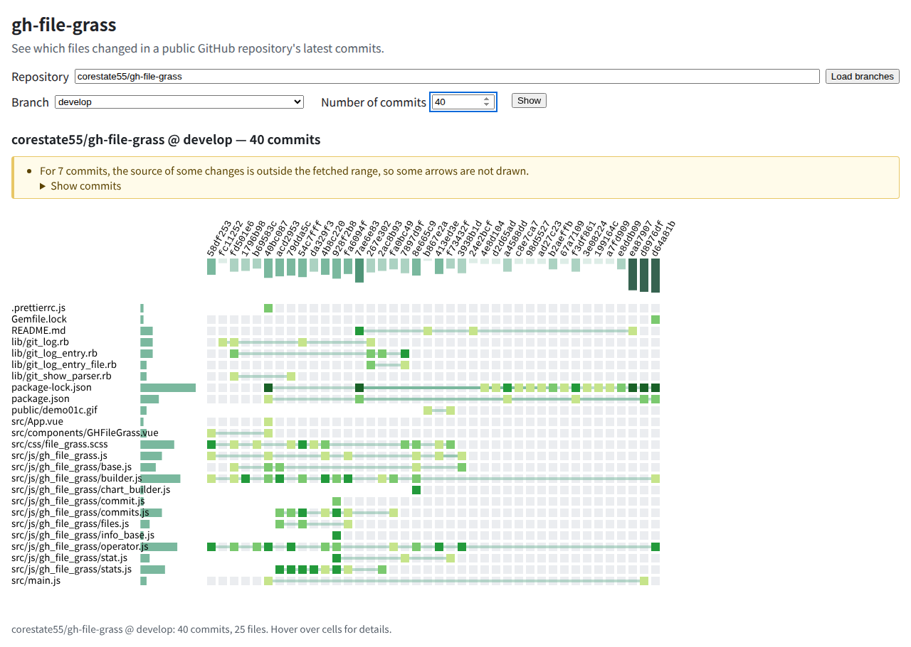
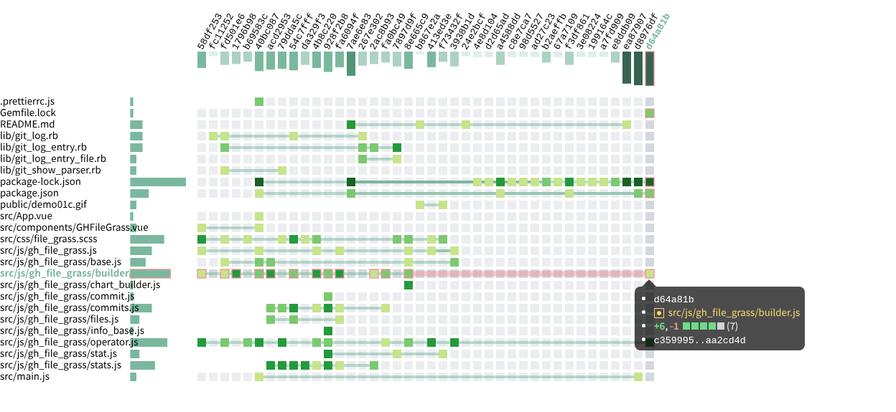

# gh-file-grass-web

See **which files changed in which commits** of any public GitHub repository, drawn like a GitHub contribution graph.

**Live: <https://corestate55.github.io/gh-file-grass-web/>**

It runs entirely in your browser. Nothing is installed, no account or token is needed, and nothing is sent anywhere except to the GitHub API.



## How to read the chart

- **Columns are commits**, oldest on the left, newest on the right. The label above each column is the short commit hash.
- **Rows are files.**
- **A green cell is a change** to that file in that commit. The darker the green, the more lines changed (relative to the commits you are looking at).
- **A pale grey cell** means the file existed at that commit but was not changed.
- **Lines between cells** connect successive changes of the same file, so you can follow a file through its history. Renames are followed: the old row ends and the new row starts at the renaming commit.
- **The bars on top** show how big each commit was (lines changed). **The bars on the left** show how many of the commits touched each file.



## How to use it

1. Open the [page](https://corestate55.github.io/gh-file-grass-web/).
2. Enter a repository and press **Load branches**. You can type any of these:
   - `owner/repo`, for example `vuejs/core`
   - `https://github.com/owner/repo` (a `.git` suffix or a `/tree/...` path is fine)
   - `github.com/owner/repo`
3. Pick a **branch** (`main` or `master` is preselected if the repository has one) and the **number of commits** to show, from 1 to 50 (default 20), then press **Show**. Pressing Enter in the number field does the same.
4. Explore the chart:
   - **Hover** a cell, a commit hash or a file name to highlight its row and column. Cells and commit hashes also show a tooltip with the details.
   - **Click** a commit hash, a file name or a cell to open it on GitHub in a new tab.
   - **Drag** the grid, or the commit and file labels, to move around a large chart.
5. Change the branch or the number of commits at any time. A running request is cancelled; commits that were already fetched are reused.

## Good to know

- **Public repositories only.** Private repositories are not supported, and there is no sign-in.
- **GitHub limits unauthenticated requests to 60 per hour** (per IP address, shared by everything on your network connection). The page shows what is left in the top right corner and tells you roughly what a click will cost _before_ you press **Show**:
  - loading the branches costs 1 request;
  - showing N commits costs up to N + 1 more.

  Commits fetched earlier on the same page are reused, but **reloading the page forgets them**, so avoid reloading repeatedly. If the remaining quota is too small, the page says how many commits you can still afford, or when the limit resets.

- **Merge commits** are shown as the changes against their first parent.
- **A commit with more than 300 changed files** is shown with only its first 300 files, and the page warns you.
- **Arrows may be missing at the edge of the range.** For the oldest commits you are looking at, the page cannot always tell which earlier change a file came from; it tells you when that happens.
- **Dates** in the tooltips use your browser's time zone.
- The chart is not designed for touch screens; hovering needs a mouse.

## Development

Requirements: Node.js 24.

```sh
npm ci
npm run dev -w @gh-file-grass/app     # http://localhost:5173/gh-file-grass-web/
npm test                              # unit tests
npm run lint && npm run typecheck     # static checks
npm run build                         # production build in app/dist
```

The repository is an npm-workspaces monorepo, written in TypeScript:

| Path                      | What it is                                                                                                       |
| ------------------------- | ---------------------------------------------------------------------------------------------------------------- |
| `packages/core`           | The chart: a framework-independent d3 renderer (`draw(data, { container })`) and its stylesheet.                 |
| `packages/github-adapter` | Turns GitHub REST API responses into the chart's data, and fetches them (rate-limit aware, cancellable, cached). |
| `app`                     | The page: Vite + Vue 3.                                                                                          |
| `docs`                    | The design (`DESIGN.md`) and notes for contributors (`HANDOVER.md`).                                             |

Development happens on `develop`. Merging into `main` publishes the page to GitHub Pages (see `.github/workflows/deploy.yml`).

## Credits and license

Based on [gh-file-grass](https://github.com/corestate55/gh-file-grass) by corestate55 (a Ruby collector with a Vue 3 and d3 visualizer), reimplemented in TypeScript so that it runs in the browser without a server.

Released under the [MIT License](LICENSE).
